# Platform Workflow — Complete Flowcharts

This document describes the end-to-end workflow of the **Manzil AI Online Assessment Platform** through a series of Mermaid flowcharts. It covers authentication, content management, student lifecycle, quiz engine, CUET multi-subject enrollment, performance analytics, and credential management.

---

## 1. Authentication Flow — Dual-Mode Login

The platform supports **two distinct authentication modes**:

- **Admin & Super Admin** — OTP-based phone login (no passwords).
- **Students** — Username + password login. Credentials are auto-generated by the system when a student is created by an org admin.

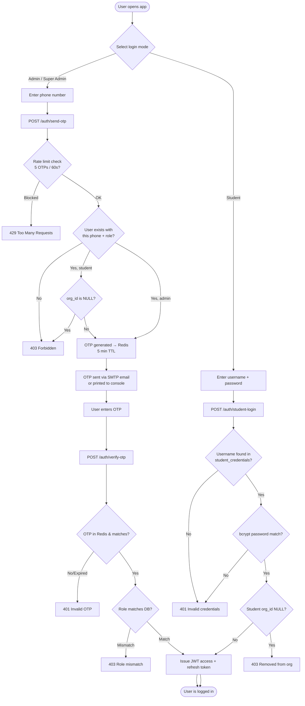

---

## 2. Super Admin Workflow

Super admins manage organizations, the global question-bank content library, and platform-wide analytics.

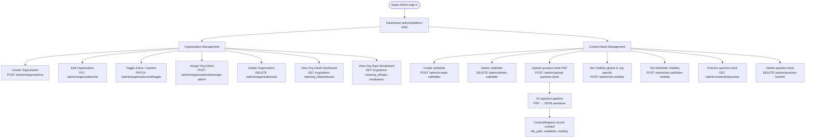

---

## 3. Organization Admin Workflow

Org admins manage their student roster (CRUD + credentials), browse question banks, and view student analytics.

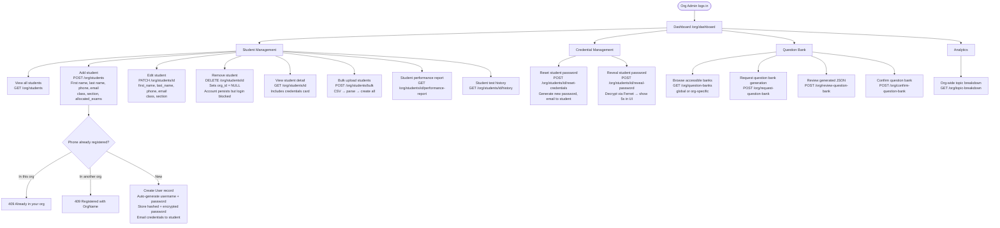

---

## 4. Student Credential Lifecycle

Student usernames and passwords are system-managed. Org admins create, reset, and reveal credentials.

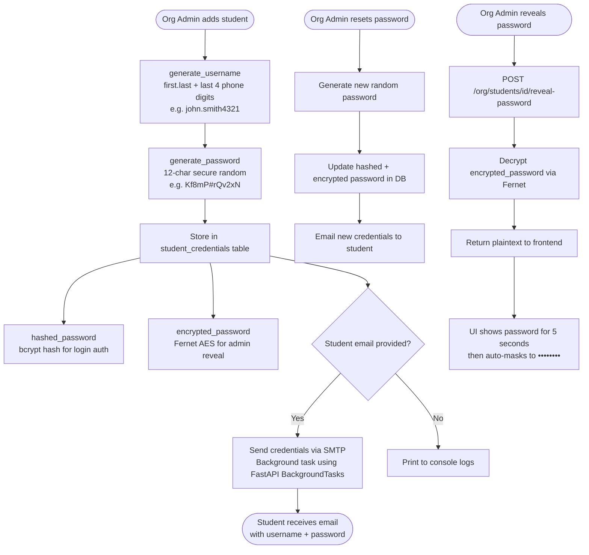

---

## 5. Student Journey — Exam Onboarding & Plan Generation

A student picks an exam and generates an AI study plan.

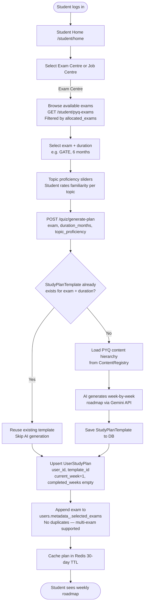

---

## 6. CUET Multi-Subject Enrollment

CUET students enroll in multiple subjects at once. Weekly tests pull questions from all enrolled subjects.

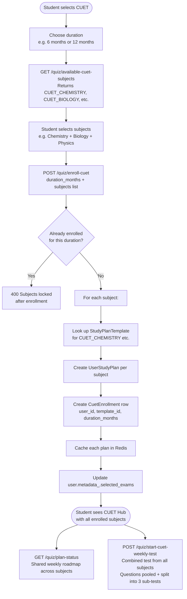

---

## 7. Student Weekly Test Flow

The core weekly learning loop — each week has 2 or 3 sub-tests depending on plan duration.

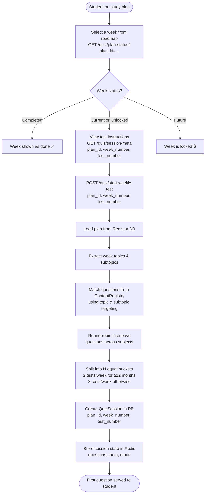

---

## 8. Quiz Engine — Answer Loop with IRT Adaptive Scoring

Each answer is scored in real-time. Ability estimate (theta) adjusts after every answer.

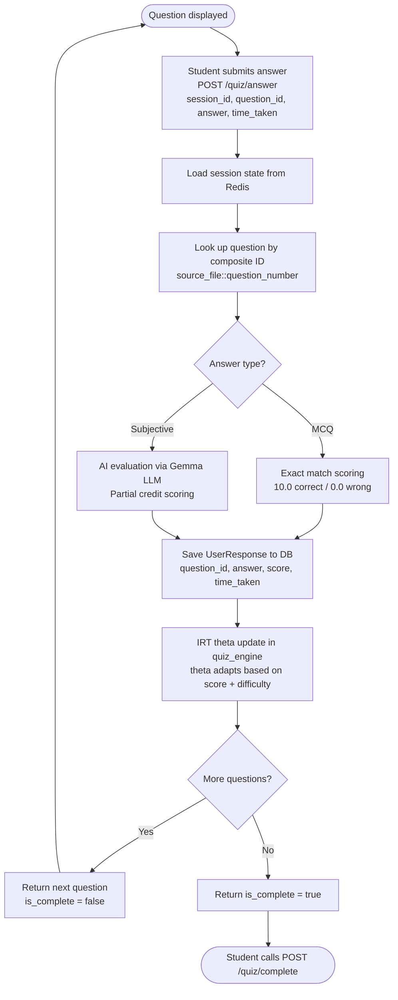

---

## 9. Quiz Completion and Result Saving

When all questions are answered, the session closes and results are fully persisted.

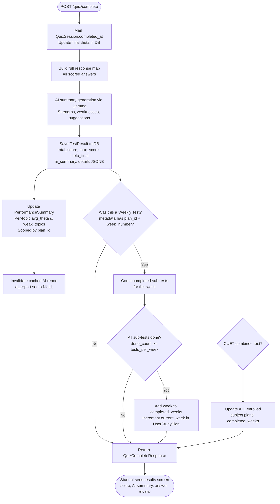

---

## 10. Student Performance and History

Students can review history and performance at any time, scoped by exam plan.

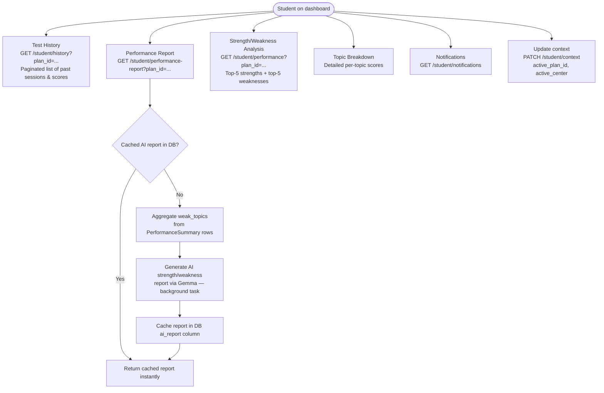

---

## 11. CUET Dashboard & Performance

Dedicated dashboard and performance analytics for CUET multi-subject enrollment.

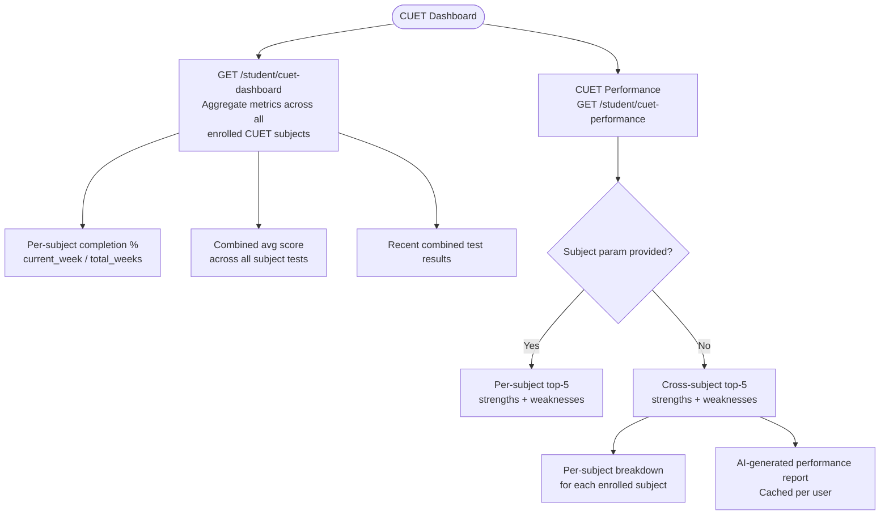

---

## 12. Job Evaluation Centre

Students can take skill-based assessments based on job descriptions.

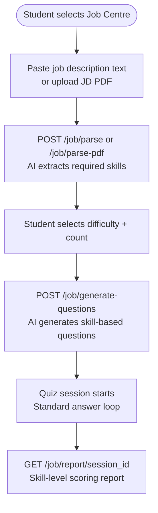

---

## 13. Email & Notification System

The platform dispatches transactional emails via Gmail SMTP.

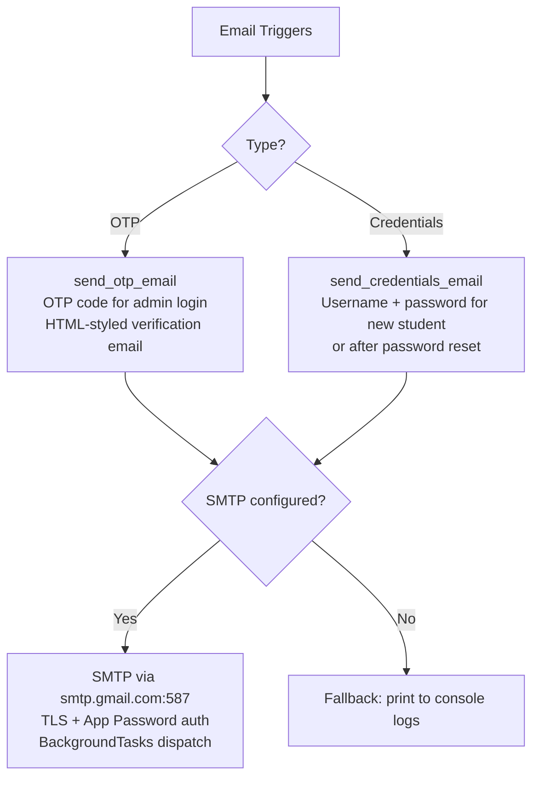

---

## 14. Data Model — Key Table Relationships

```mermaid
erDiagram
    users {
        uuid id PK
        string phone
        string email
        string first_name
        string last_name
        enum role
        uuid org_id FK
        jsonb metadata_
        datetime created_at
    }

    organizations {
        uuid id PK
        string name UK
        string slug UK
        jsonb config
        bool is_active
    }

    subscriptions {
        uuid id PK
        uuid org_id FK
        string plan
        datetime valid_until
        jsonb limits
    }

    student_credentials {
        uuid id PK
        uuid user_id FK UK
        string username UK
        string hashed_password
        string encrypted_password
    }

    content_registry {
        uuid id PK
        string title
        string subfolder
        string file_path
        enum source_type
        enum visibility
        int question_count
    }

    content_access {
        uuid id PK
        uuid registry_id FK
        uuid org_id FK
    }

    study_plan_templates {
        uuid id PK
        string exam
        int duration_months
        text plan
    }

    user_study_plans {
        uuid id PK
        uuid user_id FK
        uuid template_id FK
        jsonb completed_weeks
        int current_week
        jsonb topic_proficiency
    }

    cuet_enrollments {
        uuid id PK
        uuid user_id FK
        uuid template_id FK
        int duration_months
    }

    quiz_sessions {
        uuid id PK
        uuid user_id FK
        uuid plan_id FK
        int week_number
        int test_number
        float theta
        string mode
        datetime completed_at
    }

    user_responses {
        uuid id PK
        uuid session_id FK
        string question_id
        string answer
        float score
        float time_taken
    }

    test_results {
        uuid id PK
        uuid session_id FK UK
        uuid user_id FK
        float total_score
        float max_score
        float theta_final
        jsonb details
        text ai_summary
    }

    performance_summary {
        uuid id PK
        uuid user_id FK
        uuid plan_id FK
        string subject
        float avg_theta
        int total_attempts
        jsonb weak_topics
        text ai_report
    }

    notifications {
        uuid id PK
        uuid user_id FK
        string title
        text body
        bool read
        string link
    }

    users ||--o| student_credentials : "has credentials"
    users ||--o{ user_study_plans : "has"
    users ||--o{ cuet_enrollments : "enrolls in"
    study_plan_templates ||--o{ user_study_plans : "drives"
    study_plan_templates ||--o{ cuet_enrollments : "linked"
    users ||--o{ quiz_sessions : "takes"
    quiz_sessions ||--o{ user_responses : "contains"
    quiz_sessions ||--|| test_results : "produces"
    users ||--o{ test_results : "owns"
    users ||--o{ performance_summary : "tracks"
    users }o--|| organizations : "belongs to"
    organizations ||--o{ subscriptions : "has"
    organizations ||--o{ content_access : "granted"
    content_registry ||--o{ content_access : "shared via"
    users ||--o{ notifications : "receives"
```

---

## 15. Infrastructure & Deployment

The platform runs as a Docker Compose stack with 5 services:

| Service     | Image                  | Port | Purpose                                         |
|-------------|------------------------|------|-------------------------------------------------|
| `postgres`  | postgres:16-alpine     | 5432 | Primary database (async via `asyncpg`)          |
| `redis`     | redis:7-alpine         | 6379 | Session state, OTP storage, plan caching        |
| `ollama`    | ollama/ollama:latest   | —    | Local LLM inference (Gemma for AI summaries)    |
| `backend`   | Custom (FastAPI + Uvicorn) | 8000 | Python 3.12, Alembic migrations, REST API       |
| `frontend`  | Custom (Vite + Nginx)  | 80   | React + TypeScript SPA, production Nginx build  |

**Database Migrations**: Alembic with async PostgreSQL dialect. Migrations run on container startup.

---

## 16. Role Access Summary

| Endpoint Group          | super_admin | org_admin | student |
|-------------------------|:-----------:|:---------:|:-------:|
| /auth/send-otp          | ✅          | ✅         | —       |
| /auth/verify-otp        | ✅          | ✅         | —       |
| /auth/student-login     | —           | —          | ✅      |
| /auth/me                | ✅          | ✅         | ✅      |
| /auth/change-phone      | ✅          | ✅         | ✅      |
| /admin/*                | ✅          | —          | —       |
| /org/dashboard          | —           | ✅         | —       |
| /org/students/*         | —           | ✅         | —       |
| /org/question-banks     | —           | ✅         | —       |
| /org/topic-breakdown    | —           | ✅         | —       |
| /org/admin-view/*       | ✅          | —          | —       |
| /student/dashboard      | —           | —          | ✅      |
| /student/history        | —           | —          | ✅      |
| /student/performance*   | —           | —          | ✅      |
| /student/cuet-*         | —           | —          | ✅      |
| /student/notifications  | —           | —          | ✅      |
| /quiz/generate-plan     | ✅          | —          | ✅      |
| /quiz/start-weekly-test | —           | —          | ✅      |
| /quiz/enroll-cuet       | —           | —          | ✅      |
| /quiz/answer + complete | —           | —          | ✅      |
| /job/*                  | ✅          | —          | ✅      |
| Content preview         | ✅          | ✅ (org)   | —       |

---

## 17. Frontend Page Structure

| Area     | Page                   | Route                              | Purpose                                      |
|----------|------------------------|------------------------------------|----------------------------------------------|
| Public   | LoginPage              | `/login`                           | Dual-mode login (OTP / username+password)    |
| Admin    | AdminDashboard         | `/admin/dashboard`                 | Platform stats & overview                    |
| Admin    | OrgManagement          | `/admin/organizations`             | Create, edit, toggle, delete orgs            |
| Admin    | ContentManagement      | `/admin/content`                   | Upload, preview, delete question banks       |
| Admin    | AdminOrgView           | `/admin/org/:id`                   | Deep-dive into specific org's analytics      |
| Org      | OrgDashboard           | `/org/dashboard`                   | Org-level summary metrics                    |
| Org      | StudentManagement      | `/org/students`                    | Student roster (add, bulk upload, edit, remove) |
| Org      | StudentDetails         | `/org/student/:id`                 | Student profile, credentials, performance    |
| Org      | StudentHistory         | `/org/student/:id/history`         | Student's past test results                  |
| Org      | QuestionBankPage       | `/org/question-banks`              | Browse & request question banks              |
| Student  | StudentHome            | `/student/home`                    | Hub: Exam Centre vs Job Centre               |
| Student  | ExamOnboarding         | `/student/exam/onboarding`         | Select exam, duration, topic proficiency     |
| Student  | ExamDashboard          | `/student/exam/dashboard`          | Plan overview, upcoming tests, stats         |
| Student  | ExamPlan               | `/student/exam/plan`               | Week-by-week roadmap with test status        |
| Student  | TestAttempt            | `/student/exam/test`               | Take a weekly test (quiz UI)                 |
| Student  | TestResult             | `/student/exam/result`             | Post-test score, AI summary                  |
| Student  | StrengthWeakness       | `/student/exam/performance`        | Top strengths & weaknesses per plan          |
| Student  | TopicBreakdown         | `/student/exam/topics`             | Detailed per-topic score breakdown           |
| Student  | CuetHub                | `/student/cuet`                    | Multi-subject CUET enrollment & roadmap      |
| Student  | CuetAnalysis           | `/student/cuet/analysis`           | CUET-specific performance analytics          |
| Student  | JobEvalPage            | `/student/job`                     | Job description evaluation flow              |
